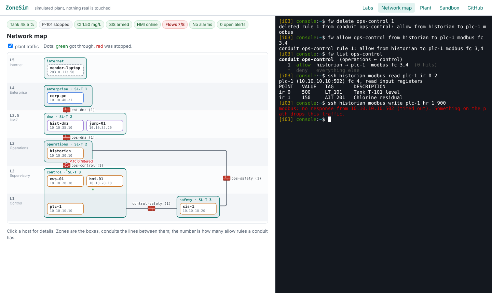

# ZoneSim

**An OT/ICS security training simulator.** Take a small water treatment plant
that sits on one flat network, and secure it: group the hosts into IEC 62443
zones, connect them with conduits and firewall rules, filter Modbus function
codes, route vendor access through a DMZ, and investigate the alerts when
someone attacks the plant. It runs in your browser or your terminal, and
nothing real is touched.

**Try it in your browser: [sdtslmn.github.io/zonesim](https://sdtslmn.github.io/zonesim/)**



## What you can do

- **Look around a working plant.** A tank, an inlet pump, chlorine dosing, a
  PLC and an independent safety system. Change a setpoint and the process
  responds. Turn off dosing and the water becomes unsafe. Bypass the safety
  system and the tank overflows.
- **Attack it from the inside.** Scan for controllers from the office PC, read
  the PLC's firmware, and write to it. Modbus has no login, so on a flat
  network that just works, and the IDS sees it.
- **Design zones and conduits.** Move hosts into zones, connect zones with
  conduits, and write least-privilege rules. Every conduit denies by default.
- **Filter Modbus.** Let the historian read with function codes 3 and 4 but
  never write, and keep the safety system read-only from the network.
- **Keep the plant running.** The plant needs eight data flows (HMI polling,
  historian collection, office reports, vendor support). Block one and the
  HMI goes blind or the reports stop, and the simulator tells you why.
- **Watch it happen.** The network map shows zones, conduits and every
  request as a dot: green when it gets through, red where a firewall stops it.
- **Get reviewed.** `report` checks your design against eight security
  checks, from "office cannot reach control" to "remote access goes through a
  jump host with MFA".

## Labs

Every lab is checked automatically, with hints and a solution.

| # | Lab | Level |
|---|---|---|
| 1 | Get to know the plant | beginner |
| 2 | Read the process over Modbus | beginner |
| 3 | Change a setpoint like an operator | beginner |
| 4 | Why a flat network is dangerous | beginner |
| 5 | Group the hosts into zones | intermediate |
| 6 | Connect the zones with conduits | intermediate |
| 7 | Filter Modbus function codes | intermediate |
| 8 | Office reports through the DMZ | intermediate |
| 9 | Vendor remote access through a jump host | intermediate |
| 10 | Investigate an unauthorized write | advanced |
| 11 | Someone bypassed the safety system | scenario |
| 12 | Segment the whole plant from scratch | scenario |

Link straight to a lab with `?lab=`, for example
[sdtslmn.github.io/zonesim/?lab=i03](https://sdtslmn.github.io/zonesim/?lab=i03).

## The plant

| Host | IP | Purdue level | Role |
|---|---|---|---|
| vendor-laptop | 203.0.113.50 | 5 Internet | Remote vendor support |
| corp-pc | 10.10.40.21 | 4 Enterprise | Office workstation |
| hist-dmz | 10.10.35.10 | 3.5 DMZ | Historian copy for office reports |
| jump-01 | 10.10.35.20 | 3.5 DMZ | Remote access jump host |
| historian | 10.10.30.10 | 3 Operations | Process historian |
| hmi-01 | 10.10.20.10 | 2 Supervisory | Operator HMI |
| ews-01 | 10.10.20.30 | 2 Supervisory | Engineering workstation |
| plc-1 | 10.10.10.10 | 1 Control | Tank and dosing PLC (Modbus TCP) |
| sis-1 | 10.10.10.20 | 1 Control | Safety instrumented system (Modbus TCP) |

The plant, the devices, the vendor and the register maps are fictional.

## A taste of the console

```
console:~$ ssh corp-pc modbus write plc-1 coil 1 0
plc-1 (10.10.10.10:502) fc 5, write single coil: coil 1 (P201_ENABLE) = 0  OK

console:~$ zone create enterprise --sl 1
console:~$ zone add enterprise corp-pc
console:~$ conduit create ent-dmz enterprise dmz
console:~$ fw allow ent-dmz from corp-pc to hist-dmz https

console:~$ fw allow ops-control from historian to plc-1 modbus fc 3,4
console:~$ test historian plc-1 modbus fc 6
✘ blocked  historian → plc-1 modbus fc 6
  function code 6 is not allowed by conduit ops-control rule 1
```

The console is an out-of-band management station: it designs zones and reads
alerts, but sends no plant traffic. To act from a host, `ssh` to it. Type
`help` for every command.

## Run it on your computer

You need Node.js 20.19 or newer.

```
git clone https://github.com/sdtslmn/zonesim.git
cd zonesim
npm install
npm run sim         # terminal version
npm run dev:web     # browser version on http://localhost:5173
```

`npm test` runs the tests and `npm run validate-labs` checks that every lab is
solved by its own solution.

## How close to reality is it?

Close enough to learn the ideas, simple enough to stay readable:

- Hosts in a zone talk freely. Traffic between zones needs a conduit between
  exactly those two zones, and its rules are checked top-down with an
  implicit deny at the end. Real networks route through several firewalls.
- Modbus TCP behaves like the real protocol for function codes 1 to 6, 15, 16
  and 43, including exceptions. Other protocols are modelled at the
  connection level only.
- The IDS uses simple rules (baseline writers, writes to the safety system,
  scans, device identification reads, remote access from the internet).
- Standards are referenced for orientation. ZoneSim is a training tool, not
  a compliance or assessment tool.

See [docs/roadmap.md](docs/roadmap.md) for what is coming next, and
[CONTRIBUTING.md](CONTRIBUTING.md) to add a lab.

## License

Apache License 2.0. See [LICENSE](LICENSE) and [NOTICE](NOTICE).
