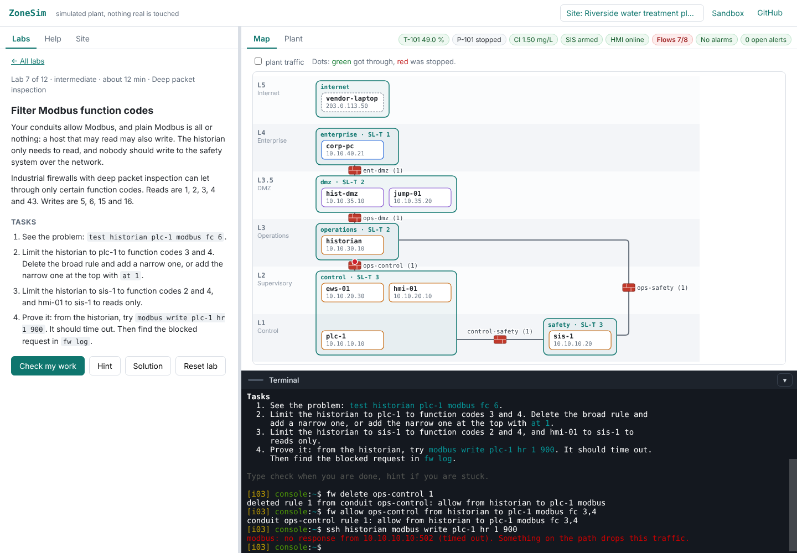
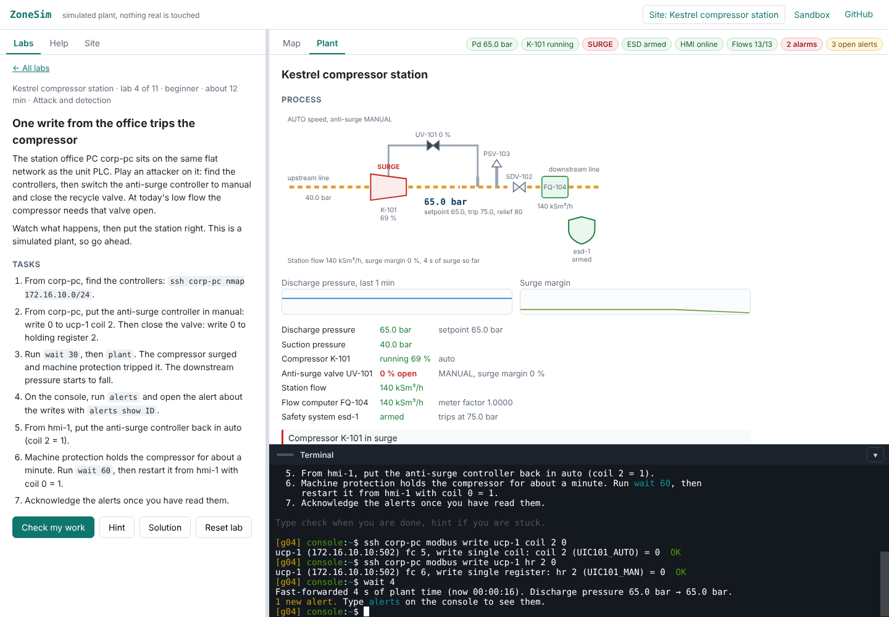
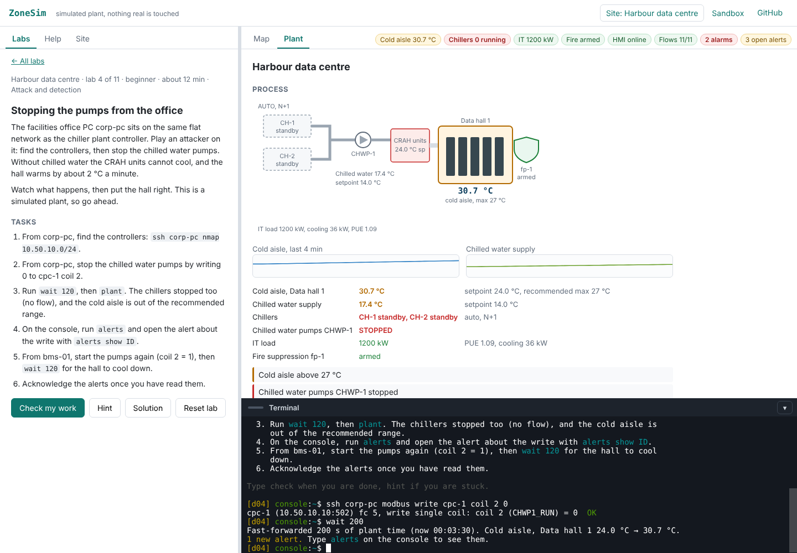
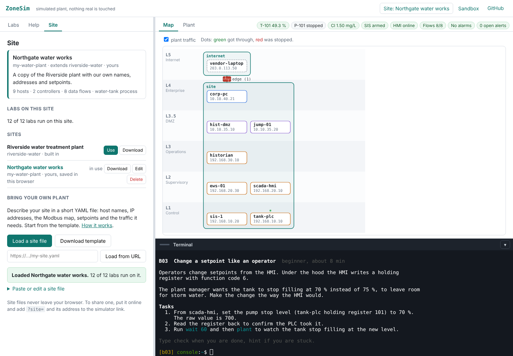
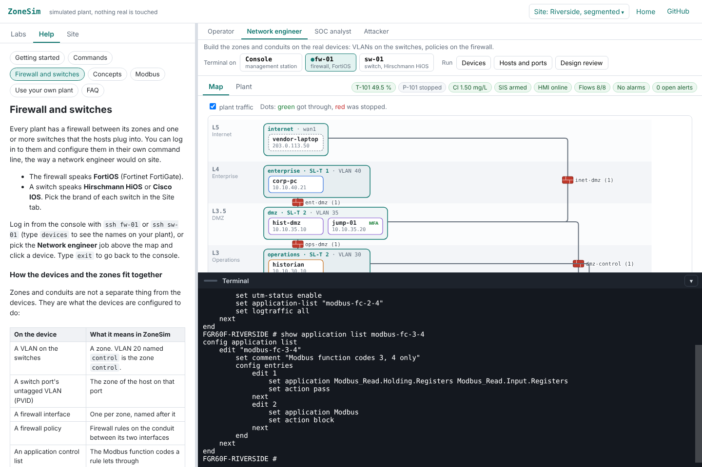
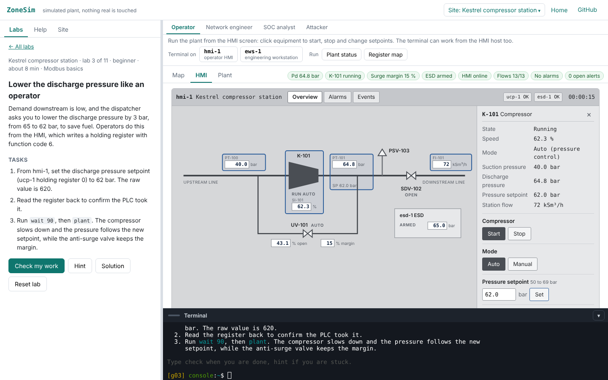

# ZoneSim

**An OT/ICS security training simulator.** Take a plant that sits on one
flat network, and secure it: group the hosts into IEC 62443 zones, connect
them with conduits and firewall rules, filter Modbus function codes, route
vendor access through a DMZ, and investigate the alerts when someone attacks
the plant. Pick a job (operator, network engineer, SOC analyst or attacker)
and work from where that person works: the HMI, the firewall and switches in
their own command lines (FortiOS, Hirschmann HiOS, Cisco IOS), the alerts, or
a foothold in the office. There are three plants to practise on (a water
treatment plant, a gas compressor station and a data centre), 34 labs, and
you can load your own site. It runs in your browser, and nothing real is
touched.

**Try it in your browser: [sdtslmn.github.io/zonesim](https://sdtslmn.github.io/zonesim/)**



*Lab 7, after the zones and conduits are in place: the historian's Modbus
write is dropped at the operations to control conduit. Every new session
starts from the flat network as found; the labs build this design step by
step. [Open this lab](https://sdtslmn.github.io/zonesim/?lab=i03), or see the
[finished design](https://sdtslmn.github.io/zonesim/?site=riverside-segmented).*

## What you can do

- **Look around a working plant.** Each plant runs a live process with real
  consequences. At Riverside, turn off dosing and the water becomes unsafe,
  or bypass the safety system and the tank overflows. At the compressor
  station, close the anti-surge valve and the compressor surges and trips,
  or bypass the ESD and the relief valve vents gas. In the data centre, stop
  the chilled water pumps and the servers shut down within minutes.
- **Run it from the HMI.** Each plant has an operator screen in the
  high-performance HMI style. Click a pump, the compressor or a chiller to
  start, stop or change a setpoint. Every command is a Modbus write from the
  HMI host through the firewall, so when your design blocks the HMI, the
  operator sees it go stale.
- **Attack it from the inside.** Scan for controllers from the office PC, read
  the PLC's firmware, and write to it. Modbus has no login, so on a flat
  network that just works, and the IDS sees it.
- **Design zones and conduits.** Move hosts into zones, connect zones with
  conduits, and write least-privilege rules. Every conduit denies by default.
- **Configure the real devices.** Each plant has a firewall and switches you
  can log in to. Create VLANs and move ports on a Hirschmann or Cisco switch,
  and write policies and application control lists on a FortiGate. Zones are
  VLANs, conduit rules are firewall policies, and both views stay in step.
- **Filter Modbus.** Let the historian read with function codes 3 and 4 but
  never write, and keep the safety system read-only from the network.
- **Keep the plant running.** Each plant needs its data flows (HMI polling,
  historian collection, the control centre, customer dashboards, vendor
  support). Block one and the HMI goes blind or the reports stop, and the
  simulator tells you why.
- **Watch it happen.** The network map shows zones, conduits and every
  request as a dot: green when it gets through, red where a firewall stops it.
- **Get reviewed.** `report` checks your design against eight security
  checks, from "office cannot reach control" to "remote access goes through a
  jump host with MFA".
- **Bring your own plant.** Describe your site in a short YAML file and load
  it in the Site tab. The labs fill in your names, addresses, registers and
  setpoints.

## Labs

Every lab is checked automatically, with hints and a solution. Each plant
has its own set, from a tour to a full zone and conduit design.

| Riverside water treatment plant | Kestrel compressor station | Harbour data centre |
|---|---|---|
| 1. Get to know the plant | 1. Get to know the compressor station | 1. Get to know the data hall |
| 2. Read the process over Modbus | 2. Read the pressures over Modbus | 2. Read temperatures and power over Modbus |
| 3. Change a setpoint like an operator | 3. Lower the discharge pressure like an operator | 3. Raise the chilled water temperature to save energy |
| 4. Why a flat network is dangerous | 4. One write from the office trips the compressor | 4. Stopping the pumps from the office |
| 5. Group the hosts into zones | 5. Group the station into zones | 5. Group the facility systems into zones |
| 6. Connect the zones with conduits | 6. Connect the zones with conduits | 6. Connect the zones with conduits |
| 7. Filter Modbus function codes | 7. Filter Modbus across the WAN | 7. Make monitoring read-only |
| 8. Office reports through the DMZ | 8. Compressor maker support through a jump host | 8. Chiller vendor support through a jump host |
| 9. Vendor remote access through a jump host | 9. The gas bill does not add up | 9. The hall is running hot |
| 10. Investigate an unauthorized write | 10. Someone bypassed the pressure trip | 10. Someone isolated the fire suppression |
| 11. Someone bypassed the safety system | 11. Segment the whole station from scratch | 11. Segment the whole facility from scratch |
| 12. Segment the whole plant from scratch | | |

Link straight to a lab with `?lab=`, for example
[?lab=i03](https://sdtslmn.github.io/zonesim/?lab=i03) (Riverside),
[?lab=g09](https://sdtslmn.github.io/zonesim/?lab=g09) (compressor station) or
[?lab=d10](https://sdtslmn.github.io/zonesim/?lab=d10) (data centre).

## The plants

| Plant | Process | Controllers | Also on the network |
|---|---|---|---|
| [Riverside water treatment plant](sites/riverside-water.yaml) | A tank filled by a pump, chlorine dosing, a high-level safety trip | plc-1, sis-1 | office PC, historian and its DMZ copy, jump host, vendor laptop |
| [Kestrel compressor station](sites/gas-compressor-station.yaml) | Pipeline compressor with discharge pressure control, anti-surge recycle, ESD trip, relief valve | ucp-1, esd-1, flow computer fc-1 | the pipeline control centre over a WAN, the compressor maker over the internet |
| [Harbour data centre](sites/data-centre-cooling.yaml) | N+1 chillers, chilled water pumps, CRAH units, IT load and PUE | cpc-1, fire panel fp-1, power meter pm-1 | BMS, DCIM, a customer portal for colocation tenants, the chiller vendor |

Every plant starts on one flat network, with every data flow working and
most security checks failing. Riverside also comes as
[riverside-segmented](sites/riverside-segmented.yaml), the same plant with the
finished design, to compare with yours. The plants, devices, vendors and
register maps are fictional.





For example, Riverside's hosts:

| Host | IP | Purdue level | Role |
|---|---|---|---|
| vendor-laptop | 203.0.113.50 | 5 Internet | Remote vendor support (`vendor`) |
| corp-pc | 10.10.40.21 | 4 Enterprise | Office workstation (`office`) |
| hist-dmz | 10.10.35.10 | 3.5 DMZ | Historian copy for office reports (`report-server`) |
| jump-01 | 10.10.35.20 | 3.5 DMZ | Remote access jump host (`jump`) |
| historian | 10.10.30.10 | 3 Operations | Process historian (`historian`) |
| hmi-01 | 10.10.20.10 | 2 Supervisory | Operator HMI (`hmi`) |
| ews-01 | 10.10.20.30 | 2 Supervisory | Engineering workstation (`ews`) |
| plc-1 | 10.10.10.10 | 1 Control | Tank and dosing PLC, Modbus TCP (`plc`) |
| sis-1 | 10.10.10.20 | 1 Control | Safety instrumented system, Modbus TCP (`sis`) |

## Use your own plant

Start from the [template](sites/templates/my-site.yaml), change what you
need, and load it in the **Site** tab. Anything you leave out comes from the
site you extend (here Riverside; the other plants work the same way):

```yaml
schema: zonesim-site/1
id: my-water-plant
name: Northgate water works
extends: riverside-water
rename: { plc-1: tank-plc, hmi-01: scada-hmi }
hosts:
  - { name: tank-plc, ip: 192.168.10.10 }
  - { name: scada-hmi, ip: 192.168.20.10 }
process:
  params: { stopLevel: 75 }
```

Labs find hosts by role, so they keep working: lab 3 now asks you to set
tank-plc's stop level from scada-hmi, to 70 %. ZoneSim checks every lab
against your site and runs the ones that do not fit on Riverside, with the
reason. Share a site with a link: `?site=https://.../my-site.yaml`.

The full guide is in [docs/help/customize.md](docs/help/customize.md), and
[schema/site.schema.json](schema/site.schema.json) gives completion in
editors such as VS Code.



## A taste of the console

```
console:~$ ssh corp-pc modbus write plc-1 coil 1 0
plc-1 (10.10.10.10:502) fc 5, write single coil: coil 1 (P201_ENABLE) = 0  OK

console:~$ zone create enterprise --sl 1
console:~$ zone add enterprise corp-pc
console:~$ conduit create ent-dmz enterprise dmz
console:~$ fw allow ent-dmz from corp-pc to hist-dmz https

console:~$ fw allow ops-control from historian to plc-1 modbus fc 3,4
console:~$ test historian plc-1 modbus fc 6
✘ blocked  historian → plc-1 modbus fc 6
  function code 6 is not allowed by conduit ops-control rule 1
```

The console is an out-of-band management station: it designs zones and reads
alerts, but sends no plant traffic. To act from a host, `ssh` to it. Type
`help` for every command, or open the **Help** tab.

The same design on the devices themselves:

```
console:~$ ssh sw-01
(Hirschmann SW-RIVERSIDE-01) > enable
(Hirschmann SW-RIVERSIDE-01) # vlan database
(Hirschmann SW-RIVERSIDE-01) (Vlan)# vlan add 20
(Hirschmann SW-RIVERSIDE-01) (Vlan)# name 20 control
...
console:~$ ssh fw-01
FGR60F-RIVERSIDE # config firewall policy
FGR60F-RIVERSIDE (policy) # edit 0
new entry '2' added
FGR60F-RIVERSIDE (2) # set srcintf "operations"
FGR60F-RIVERSIDE (2) # set dstintf "control"
FGR60F-RIVERSIDE (2) # set service "MODBUS"
FGR60F-RIVERSIDE (2) # set application-list "modbus-read"
```



See [Firewall and switches](docs/help/devices.md) for the commands. ZoneSim
imitates these command lines for practice and is not affiliated with
Fortinet, Belden (Hirschmann) or Cisco.



## The screen

Labs, Help and Site are on the left. Above the map, pick your job: it sets
where the terminal is connected (the HMI, a switch, the firewall, the
console or a host in the office) and gives you the commands that job uses
most. The network map, the HMI and the plant view are on the top right,
with a status strip. The HMI shows what the operator sees; the plant view
shows the real process. The terminal is docked at the bottom:
drag its edge to resize it, or fold it away. The **Site** button in the top
bar switches plant in one click, and **Home** brings you back to the start
page. On a phone the panels stack behind a tab bar.

## Run it on your computer

You need Node.js 20.19 or newer.

```
git clone https://github.com/sdtslmn/zonesim.git
cd zonesim
npm install
npm run dev:web                      # the simulator on http://localhost:5173
npm run validate -- my-site.yaml     # check a site file, and which labs run on it
```

`npm test` runs the tests and `npm run validate-labs` checks that every lab is
solved by its own solution.

## How close to reality is it?

Close enough to learn the ideas, simple enough to stay readable:

- Hosts in a zone talk freely. Traffic between zones needs a conduit between
  exactly those two zones, and its rules are checked top-down with an
  implicit deny at the end. Each plant has one central firewall; real
  networks often route through several.
- The device command lines cover what zones, conduits and Modbus filtering
  need (VLANs, ports, policies, addresses, services, application control,
  the traffic log), not everything the real products do.
- Modbus TCP behaves like the real protocol for function codes 1 to 6, 15, 16
  and 43, including exceptions. Other protocols are modelled at the
  connection level only.
- The IDS uses simple rules (baseline writers, writes to the safety system,
  scans, device identification reads, remote access from the internet).
- Standards are referenced for orientation. ZoneSim is a training tool, not
  a compliance or assessment tool.

See [docs/roadmap.md](docs/roadmap.md) for what is coming next, and
[CONTRIBUTING.md](CONTRIBUTING.md) to add a lab.

## License

Apache License 2.0. See [LICENSE](LICENSE) and [NOTICE](NOTICE).
